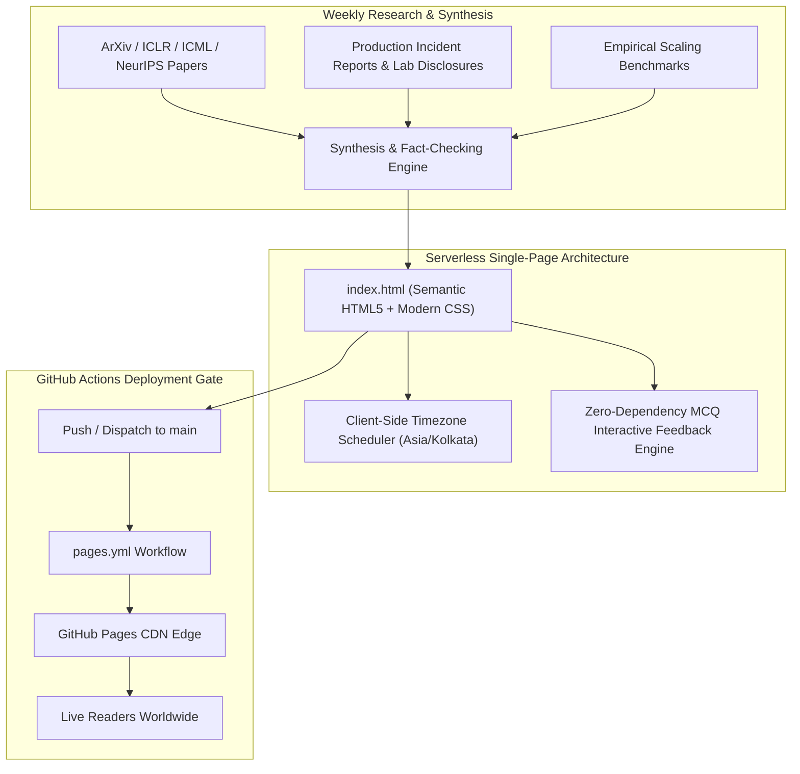

# 📈 Data, at Scale — Weekly Research Brief

[](https://tripathiswastik.github.io/Weekly-data-scaling-newsletter/)
[](LICENSE)
[](https://tripathiswastik.github.io/Weekly-data-scaling-newsletter/)
[](index.html)
[](https://www.linkedin.com/in/swastik-tripathi-52333511a/)

A focused weekly research brief evaluating one fundamental question in AI systems: **Does scaling training data always improve deep-learning model performance?**

> 🌐 **Read the Live Edition:** **[https://tripathiswastik.github.io/Weekly-data-scaling-newsletter/](https://tripathiswastik.github.io/Weekly-data-scaling-newsletter/)** (No installation or sign-up required)

---

## 🧭 Editorial & Research Scope

Every week, *Data, at Scale* analyzes peer-reviewed papers, empirical benchmarks, and production post-mortems across four core pillars:

1. **Quality vs. Quantity Tradeoffs**: Evaluating whether strict heuristic filtering, model-guided rewriting, or deduplication shift the exponents of neural scaling laws.
2. **Repetition & Diminishing Returns**: Measuring when overtraining on a narrow high-quality data pool leads to degradation compared to fresh tokens.
3. **Compute-Optimal Allocation**: Determining how token volume, parameter count, and training duration interact under fixed dollar and GPU-hour budgets.
4. **Data Infrastructure & Security**: Auditing the dataset loading pipeline, worker sandboxing, and adversarial data ingestion risks.

---

## 🌟 Key Features of the Brief

- **⚡ 3-Minute Featured Research Story**: Distilled synthesis of foundational findings (e.g., ICLR & ICML scaling law breakthroughs) grounded with direct citations.
- **📋 Actionable Takeaway Box**: Bulleted engineering heuristics distinguishing empirical results from practical inferences.
- **📡 "More Signals" Radar**: Compact summaries of emerging underdogs, production security alerts, and framework updates.
- **🧩 Interactive Reader Quiz**: Zero-latency interactive MCQ checking reader comprehension with live feedback states.
- **⏰ Autonomous Weekly Edition Counter**: Client-side timezone-aware scheduler (`Asia/Kolkata`) that dynamically derives the edition number, publication date, and next-brief countdown from the launch epoch without build steps or server dependencies.

---

## 🏗️ System Architecture & Workflow



---

## 📂 Repository Structure

```text
Weekly-data-scaling-newsletter/
├── index.html                  # Responsive single-page brief, styles, issue logic & quiz
├── LICENSE                     # Open-source MIT License
├── README.md                   # Project documentation & publication guide
└── .github/
    └── workflows/
        └── pages.yml           # Automated GitHub Pages CI/CD deployment workflow
```

---

## 🚀 Local Development & Preview

There are no build dependencies, node modules, or bundlers required.

### Option 1: Direct File Open
Open `index.html` directly in any web browser:
```bash
# Windows
start index.html

# macOS
open index.html

# Linux
xdg-open index.html
```

### Option 2: Local HTTP Server (Recommended)
```bash
# Python 3
python -m http.server 8000
```
Then visit `http://localhost:8000` in your browser.

---

## 🔄 Publishing a New Weekly Edition

1. Open `index.html` and replace the featured story, citations, and bulleted breakdown.
2. Update the "More signals from this week" cards and the reader quiz questions.
3. Commit and push changes to `main`:
   ```bash
   git add index.html
   git commit -m "feat(edition): publish Weekly Brief Issue #N"
   git push origin main
   ```
4. The `.github/workflows/pages.yml` workflow will automatically validate and deploy the latest edition to GitHub Pages within seconds.

---

## 👤 Author & Curator

- **Swastik Tripathi** — [GitHub (@tripathiswastik)](https://github.com/tripathiswastik) • [LinkedIn](https://www.linkedin.com/in/swastik-tripathi-52333511a/)

---

## 📄 License

This project is open-source and licensed under the [MIT License](LICENSE).

---

## 🏷️ Repository Metadata & Topic Tags
- **About Description**: Weekly research brief analyzing neural scaling laws, training data quality vs. quantity tradeoffs, and compute-optimal pretraining mixtures.
- **Core Topics**: `deep-learning` `data-scaling` `scaling-laws` `pretraining` `llm-data` `ai-research` `newsletter` `github-pages` `machine-learning`
